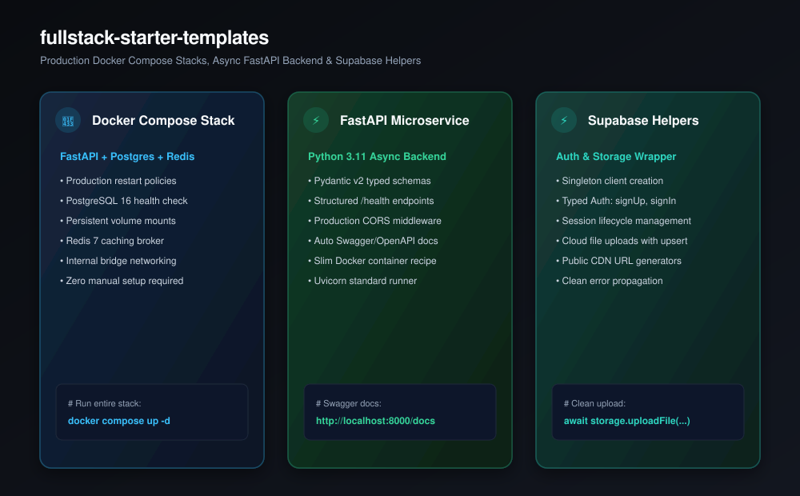

# fullstack-starter-templates

[](https://github.com/nilkanthdesai76/fullstack-starter-templates/actions/workflows/ci.yml)
[](https://fastapi.tiangolo.com)
[](https://www.docker.com)
[](https://www.postgresql.org)
[](https://supabase.com)
[](LICENSE)

Production-ready backend starters, multi-service Docker Compose stacks, and Supabase client wrappers designed for rapid deployment with zero friction.

<p align="center">
  
</p>

---

## ⚡ Included Starters

| Starter | Stack | Description | Directory |
| :--- | :--- | :--- | :--- |
| **Docker Compose Stack** | Docker, Postgres 16, Redis 7, FastAPI | Multi-container production stack with health checks and persistent storage. | [`docker-compose/`](docker-compose/docker-compose.yml) |
| **FastAPI Microservice** | Python 3.11, Pydantic v2, Uvicorn | Async REST API with `/health`, CORS, typed schemas, and auto Swagger docs. | [`fastapi-starter/`](fastapi-starter/) |
| **Supabase Helper Wrapper** | JavaScript / TypeScript, Supabase JS | Typed authentication (signup/login/session) and storage upload helper. | [`supabase-wrapper/`](supabase-wrapper/supabase.js) |

---

## 🚀 Quick Start

### 1. Spin up the entire Docker Compose Stack

```bash
cd docker-compose
docker compose up -d
```

- API is live at `http://localhost:8000`
- Swagger UI docs at `http://localhost:8000/docs`
- PostgreSQL at `localhost:5432`
- Redis at `localhost:6379`

### 2. Standalone FastAPI Development

```bash
cd fastapi-starter
pip install -r requirements.txt
uvicorn main:app --reload
```

### 3. Supabase Auth & Storage

```javascript
import { initSupabase, SupabaseAuthHelper, SupabaseStorageHelper } from "./supabase-wrapper/supabase.js";

const client = initSupabase(process.env.SUPABASE_URL, process.env.SUPABASE_ANON_KEY);
const auth = new SupabaseAuthHelper(client);
const storage = new SupabaseStorageHelper(client, "avatars");

// Sign in
await auth.signIn("user@example.com", "password123");

// Upload file
await storage.uploadFile("profile.png", fileBuffer);
```

---

## 📄 License

This repository is licensed under the [MIT License](LICENSE).
